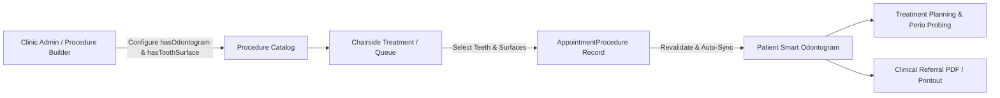

# Dently Smart Odontogram & Clinical Dental Charting System

## 1. Executive Summary

Dently's **Smart Odontogram & Dental Charting System** provides an interactive, anatomically accurate, multi-tenant digital dental chart. It eliminates disconnected paper charts by binding appointment treatments, billing transactions, procedure definitions, and chairside findings into an immutable, unified patient dental record.

Every procedure configured with tooth or surface requirements in the **Procedure Builder** automatically feeds into the patient's dental chart without manual double-entry.



---

## 2. Anatomical Chart Architecture & Orientation

The chart layout strictly follows international clinical dental conventions. The chart represents the patient facing the clinician.

```
                  MAXILLARY ARCH (UPPER JAW)
              Patient's Right                Patient's Left
         [Quadrant 1: Teeth 18-11]  |  [Quadrant 2: Teeth 21-28]
  ══════════════════════════════════╪══════════════════════════════════
         [Quadrant 4: Teeth 48-41]  |  [Quadrant 3: Teeth 31-38]
              Patient's Right                Patient's Left
                  MANDIBULAR ARCH (LOWER JAW)
```

### Supported Dentition Types

1. **Permanent Dentition (Adult - 32 Teeth)**:
   - Maxillary Right (Q1): `18, 17, 16, 15, 14, 13, 12, 11`
   - Maxillary Left (Q2): `21, 22, 23, 24, 25, 26, 27, 28`
   - Mandibular Left (Q3): `31, 32, 33, 34, 35, 36, 37, 38`
   - Mandibular Right (Q4): `48, 47, 46, 45, 44, 43, 42, 41`
2. **Primary Dentition (Pediatric / Deciduous - 20 Teeth)**:
   - Upper Right Primary (Q5): `55, 54, 53, 52, 51` (Universal: A–E)
   - Upper Left Primary (Q6): `61, 62, 63, 64, 65` (Universal: F–J)
   - Lower Left Primary (Q7): `71, 72, 73, 74, 75` (Universal: K–O)
   - Lower Right Primary (Q8): `85, 84, 83, 82, 81` (Universal: P–T)

### Universal Numbering Notation Switcher

Dentists can toggle between three international dental numbering systems on the fly:

- **FDI Two-Digit System** (ISO 3950 default): Quadrant number followed by tooth position (`11` to `48`).
- **Universal Numbering System** (US standard): Sequential numbers `#1` through `#32` for adults; letters `A` through `T` for primary teeth.
- **Palmer Notation Method**: Quadrant grid bracket symbols (`┘`, `└`, `┐`, `┌`).

---

## 3. Five-Surface Facet Restorative Diagram

Every tooth is mapped to an anatomical 5-surface facet diagram:

```
                    [ B / F ]
                 Buccal / Facial
               ┌─────────────────┐
               │ \             / │
               │   \         /   │
     [ M ]     │     ┌─────┐     │     [ D ]
    Mesial     │  M  │  O  │  D  │    Distal
               │     └─────┘     │
               │   /         \   │
               │ /             \ │
               └─────────────────┘
                 Lingual / Palatal
                    [ L / P ]
```

- **O / I (Occlusal / Incisal)**: The center facet; grinding surface of molars/premolars or cutting edge of incisors/canines.
- **M (Mesial)**: The proximal surface facing toward the dental midline.
- **D (Distal)**: The proximal surface facing away from the dental midline.
- **B / F (Buccal / Facial)**: The outer surface facing the cheeks (posterior) or lips (anterior).
- **L / P (Lingual / Palatal)**: The inner surface facing the tongue (mandibular) or palate (maxillary).

When a restorative filling (e.g. `MOD` or `DO`) is entered, only the corresponding facets are highlighted.

---

## 4. Clinical Status & Color-Coding Symbology

| Clinical Condition        | Representation       | Color Token / Fill                | Description                                      |
| :------------------------ | :------------------- | :-------------------------------- | :----------------------------------------------- |
| **Completed Restoration** | Facet Highlight      | Cyan Solid (`#0393b8`)            | Performed and verified at the clinic.            |
| **Planned Care**          | Facet / Crown Stripe | Amber Dashed (`#f59e0b`)          | Scheduled or proposed treatment.                 |
| **Sound / Natural**       | White Enamel         | Slate Border (`#94a3b8`)          | Healthy, untreated tooth structure.              |
| **Extracted / Missing**   | Red Diagonal Cross   | Rose Red `✕` (`#e11d48`)          | Tooth absent or surgically extracted.            |
| **Endodontic Treatment**  | Root Canal Lines     | Vibrant Purple (`#9333ea`)        | Root canal therapy with guttapercha obturation.  |
| **Full Coverage Crown**   | Gold/Bronze Cap      | Metallic Gold (`#d97706`)         | PFM, Zirconia, or porcelain prosthetic crown.    |
| **Dental Implant**        | Threaded Cylinder    | Dark Slate / Titanium (`#0f172a`) | Osseointegrated implant fixture.                 |
| **Fixed Bridge**          | Solid Connector Bar  | Cyan/Gold Beam (`#0891b2`)        | Connects abutment crowns across missing pontics. |

---

## 5. Chairside Workflow & Treatment Integration

### A. Entering Treatments During a Visit

1. From the **Chairside Treatment Console** (`treatment-client.tsx`) or **Add Procedure Dialog** (`add-procedure-dialog.tsx`), select a procedure from the dropdown.
2. If the procedure requires an Odontogram, the anatomical 8-column arch layout displays immediately.
3. Click one or more target teeth:
   - For restorations (Composite Filling, Sealant), click a tooth and toggle the exact surfaces (`M`, `O`, `D`, `B`, `L`).
   - For extractions, crowns, or root canals, clicking the tooth number assigns the procedure directly.
4. Add optional clinical notes, materials used (e.g. `Filtek Z350`), and tooth shades (e.g. `A2`, `A3`).
5. Click **Add Procedure**.

### B. Automatic Smart Chart Update

- When the queue or treatment status advances or when the invoice is settled at billing, the system calls `revalidatePath` for `/clinic/[slug]/admin/patients/[patientId]`.
- All historical visits are aggregated:
  - Appointments with status `COMPLETED` or `CHECKED_IN` render in solid colors.
  - Appointments with status `PENDING` or `CONFIRMED` render as planned treatment.
  - Voided visits (`CANCELLED`, `NO_SHOW`) are automatically filtered out.

### C. Fast Chairside Stamping Toolbar

In the **Patient Detail > Dental Chart** tab, clinicians can make instantaneous chart adjustments without navigating through modal menus:

- `+ Filling`: Click to stamp a composite restoration on any tooth facet.
- `+ Crown`: Click to crown any tooth.
- `+ Endo`: Click to draw root canal therapy on any tooth.
- `✕ Extract`: Click to toggle tooth presence/absence.
- `Sound`: Click to reset tooth condition to healthy enamel.

> [!NOTE]
> Manual missing tooth overrides are persisted in the patient's record using structured medical note annotations (`[TOOTH_MISSING:<tooth>]` / `[TOOTH_PRESENT:<tooth>]`). They remain permanent across page reloads and devices.

---

## 6. Periodontal Probing Module (Perio Charting)

Switching to the **Periodontal Charting** tab enables full 6-point periodontal depth recording per tooth:

```
  Maxillary / Mandibular 6-Point Probing Locations:
  ┌───────────────┬──────────────┬───────────────┐
  │ Mesio-Buccal  │ Mid-Buccal   │ Disto-Buccal  │
  │     (MB)      │     (B)      │     (DB)      │
  ├───────────────┼──────────────┼───────────────┤
  │ Mesio-Lingual │ Mid-Lingual  │ Disto-Lingual │
  │     (ML)      │     (L)      │     (DL)      │
  └───────────────┴──────────────┴───────────────┘
```

- **Probing Pocket Depths (PPD)**: Numerical values in millimeters ($1\text{ to }9\text{ mm}$). Pockets $\ge 4\text{ mm}$ are automatically highlighted with red badges indicating periodontal breakdown.
- **Bleeding on Probing (BOP)**: Toggleable red drop indicator.
- **Tooth Mobility**: Standard Miller Classification (`Grade 0`, `Grade I`, `Grade II`, `Grade III`).

---

## 7. Developer & Database Specification

### Component Architecture

| Component             | File Path                                   | Responsibilities                                                                                                                                 |
| :-------------------- | :------------------------------------------ | :----------------------------------------------------------------------------------------------------------------------------------------------- |
| `<Odontogram />`      | `src/components/ui/odontogram.tsx`          | Lightweight interactive tooth & surface selector used inside treatment dialogs and billing forms. Controlled & uncontrolled support.             |
| `<SmartOdontogram />` | `src/components/admin/smart-odontogram.tsx` | Full comprehensive clinical dental chart in the patient profile. Dual arch, adult/pediatric, perio probing, stamping toolbar, referral printout. |

### Prisma Schema Relationship

```prisma
model Procedure {
  id                   String    @id @default(cuid())
  clinicId             String
  name                 String
  category             String?
  hasOdontogram        Boolean   @default(false)
  hasToothSurface      Boolean   @default(false)
  hasMaterial          Boolean   @default(false)
  hasShade             Boolean   @default(false)
  hasUpperLower        Boolean   @default(false)
  ...
}

model AppointmentProcedure {
  id                String       @id @default(cuid())
  appointmentId     String
  procedureId       String
  toothSelection    String?      // JSON array, e.g. "[16, 17]"
  surfaceSelection  String?      // JSON object, e.g. "{\"16\":[\"Mesial\",\"Occlusal\"]}"
  findings          String?
  diagnosis         String?
  remarks           String?
  ...
}
```

### Procedure Classification Engine

The procedure classifier (`classifyProcedure`) determines the visual rendering style from clinical procedure names and categories:

```typescript
export function classifyProcedure(
  name: string,
  category?: string | null,
): ProcedureKind {
  const text = `${name} ${category || ""}`.toLowerCase();
  if (text.match(/extract|bunot|odontectomy|missing|avuls/)) return "missing";
  if (text.match(/root canal|endodontic|pulpectomy|pulpotomy|rct/))
    return "endodontic";
  if (text.match(/crown|bridge|veneer|pontic|jacket/)) return "crown";
  if (text.match(/implant|fixture|abutment/)) return "implant";
  if (text.match(/restoration|filling|composite|amalgam|sealant/))
    return "restoration";
  return "general";
}
```

---

## 8. Clinical Letterhead & Referral Printout

Clicking **Print / Export Chart** on the Smart Odontogram generates an official print-optimized letterhead document (`@media print` compliant) that includes:

- Clinic branding, attending dentist license number, and patient demographics.
- Full graphical dental chart snapshot.
- Detailed tooth-by-tooth historical treatment log.
- Periodontal probing risk summary.
- Official doctor signature line for clinical referral to specialists.
